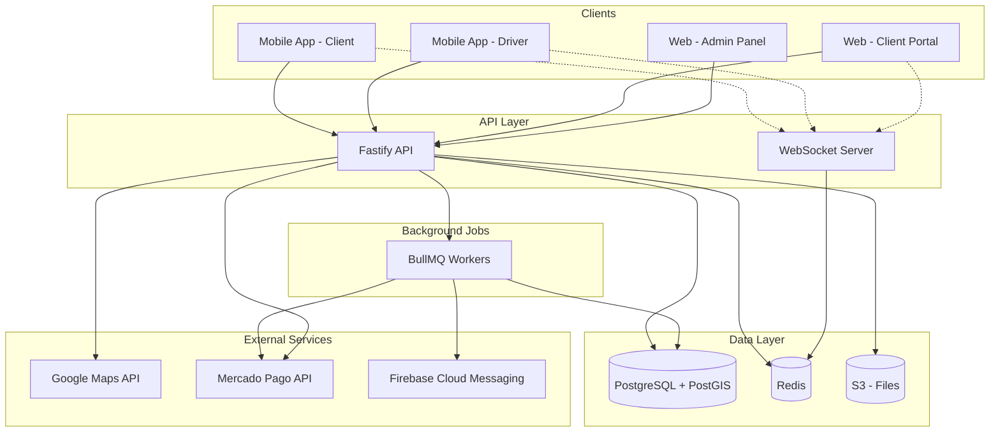
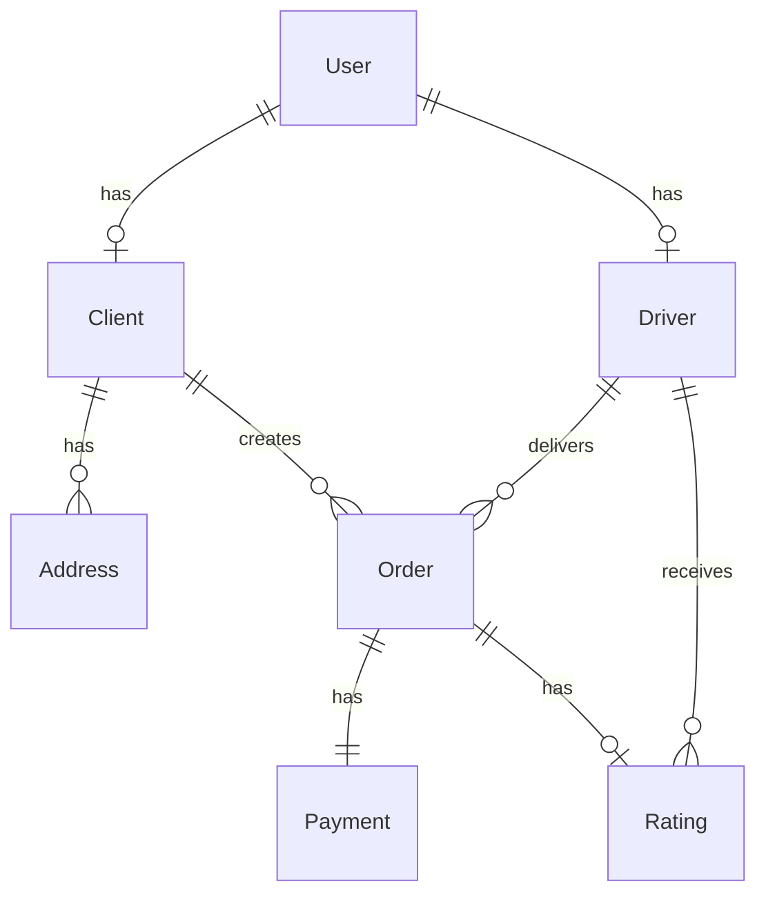
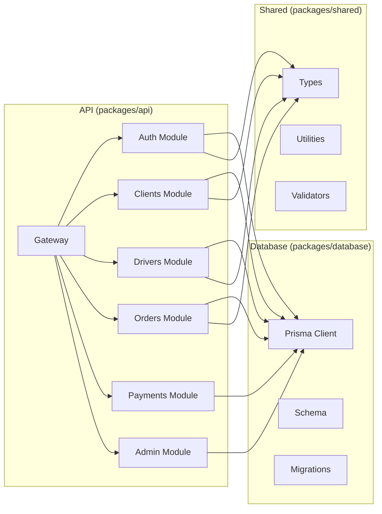
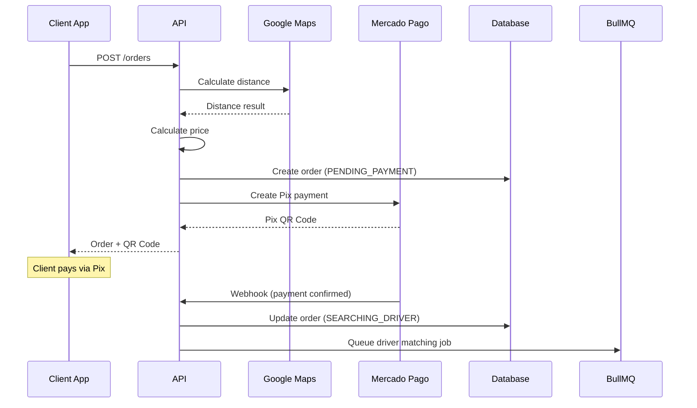
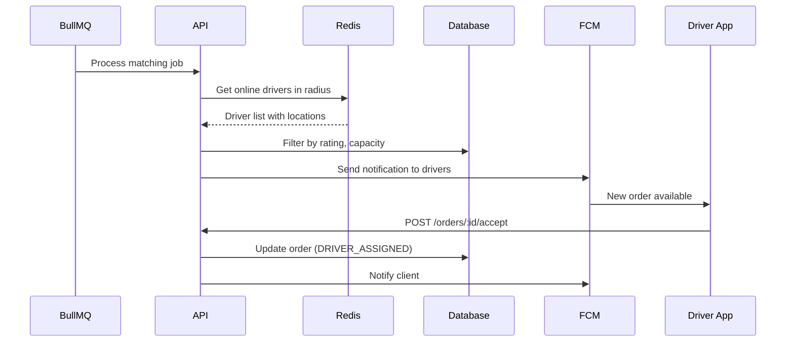
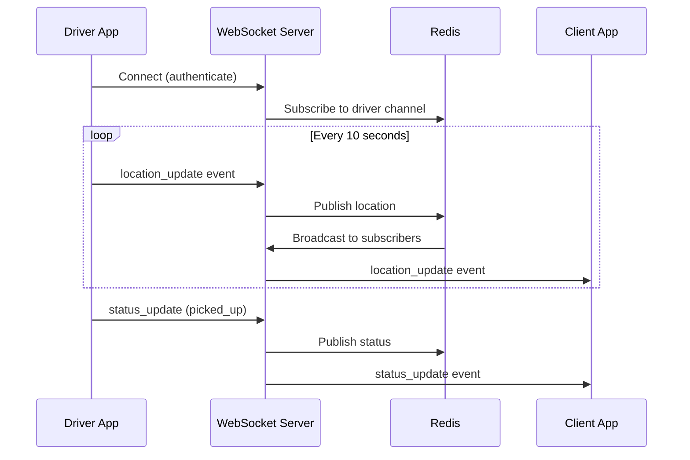

# Rotax1 - Architecture Document

**Version:** 1.0
**Status:** Draft
**Author:** Architect Agent (Winston - BMAD)
**Date:** 2026-01-23

---

## 1. Introduction

This document outlines the overall project architecture for Rotax1, a last-mile logistics marketplace platform. It covers backend systems, mobile applications, web interfaces, and infrastructure concerns. The primary goal is to serve as the guiding architectural blueprint for AI-driven development, ensuring consistency and adherence to chosen patterns and technologies.

### 1.1 Starter Template

**N/A** - This is a greenfield project. We will set up the monorepo structure manually using pnpm workspaces with best practices for each technology in the stack.

### 1.2 Change Log

| Date | Version | Description | Author |
|------|---------|-------------|--------|
| 2026-01-23 | 1.0 | Initial architecture document | Architect Agent |

---

## 2. High Level Architecture

### 2.1 Technical Summary

Rotax1 follows a **Modular Monolith** architecture within a **pnpm Monorepo** structure. The system consists of a Node.js/Fastify API backend, React Native mobile applications (client and driver), Next.js web applications (client portal and admin panel), and PostgreSQL with PostGIS for data persistence. Real-time features are powered by WebSockets (Socket.IO), and async processing uses BullMQ with Redis. The architecture prioritizes development velocity for MVP while maintaining clear module boundaries for future microservices extraction.

### 2.2 High Level Overview

**Architecture Style:** Modular Monolith
**Repository Structure:** Monorepo (pnpm workspaces)
**Service Architecture:** Single API with domain modules
**Communication:** REST API + WebSocket for real-time

**Key Architectural Decisions:**
1. **Monolith for MVP** - Faster development, simpler deployment, easier debugging
2. **Module boundaries** - Clear separation by domain (clients, drivers, orders, payments) enables future extraction
3. **Shared packages** - Common types, utilities, and UI components reduce duplication
4. **Mobile-first** - React Native with Expo for rapid cross-platform development

### 2.3 High Level Project Diagram



### 2.4 Architectural and Design Patterns

- **Modular Monolith:** Single deployable unit with clear domain boundaries - *Rationale:* Balances simplicity with maintainability, ideal for MVP stage
- **Repository Pattern:** Abstract data access through repositories - *Rationale:* Enables testing, hides Prisma implementation details
- **Service Layer:** Business logic in dedicated service classes - *Rationale:* Keeps controllers thin, improves testability
- **Event-Driven (Internal):** Domain events for cross-module communication - *Rationale:* Loose coupling between modules, prepares for future microservices
- **CQRS Lite:** Separate read/write models for complex queries - *Rationale:* Optimizes read-heavy operations like driver matching

---

## 3. Tech Stack

### 3.1 Cloud Infrastructure

- **Provider:** Railway (MVP) / AWS (Scale)
- **Key Services:** PostgreSQL, Redis, S3-compatible storage
- **Deployment Regions:** São Paulo (sa-east-1)

### 3.2 Technology Stack Table

| Category | Technology | Version | Purpose | Rationale |
|----------|------------|---------|---------|-----------|
| **Language** | TypeScript | 5.3+ | Primary language | Type safety, excellent tooling |
| **Runtime** | Node.js | 20 LTS | Backend runtime | Stable, performant, wide ecosystem |
| **Backend Framework** | Fastify | 4.x | API framework | High performance, schema validation |
| **ORM** | Prisma | 5.x | Database access | Type-safe queries, migrations |
| **Database** | PostgreSQL | 16 | Primary database | Reliable, PostGIS support |
| **Spatial Extension** | PostGIS | 3.4 | Geospatial queries | Driver matching, distance calc |
| **Cache** | Redis | 7.x | Cache & sessions | Fast, pub/sub for WebSocket |
| **Queue** | BullMQ | 5.x | Job processing | Notifications, payments |
| **WebSocket** | Socket.IO | 4.x | Real-time | Tracking, notifications |
| **Mobile** | React Native | 0.73+ | Mobile apps | Cross-platform, Expo support |
| **Mobile Tooling** | Expo | SDK 50+ | Development | Fast iteration, OTA updates |
| **Web Framework** | Next.js | 14+ | Web apps | SSR, App Router, RSC |
| **UI Library** | Tailwind CSS | 3.x | Styling | Utility-first, consistent |
| **State (Mobile)** | Zustand | 4.x | State management | Simple, performant |
| **Data Fetching** | TanStack Query | 5.x | Server state | Caching, sync |
| **Maps** | Google Maps API | - | Geolocation, routes | Accurate, feature-rich |
| **Payments** | Mercado Pago | - | Pix, cards | Brazil leader, good API |
| **Push Notifications** | FCM | - | Mobile push | Free, reliable |
| **File Storage** | Cloudflare R2 | - | Images, docs | S3-compatible, cheap |
| **Auth** | JWT + bcrypt | - | Authentication | Standard, secure |
| **Validation** | Zod | 3.x | Schema validation | TypeScript integration |
| **Testing** | Vitest | 1.x | Unit/Integration | Fast, ESM native |
| **E2E Testing** | Detox | 20.x | Mobile E2E | React Native support |
| **Linting** | ESLint + Prettier | - | Code quality | Consistency |
| **Monorepo** | pnpm | 8.x | Package manager | Fast, workspace support |

---

## 4. Data Models

### 4.1 User
**Purpose:** Base entity for all platform users with authentication data.

**Key Attributes:**
- `id`: UUID - Primary identifier
- `email`: String - Unique email for login
- `phone`: String - Phone number with country code
- `password_hash`: String - Bcrypt hashed password
- `role`: Enum - CLIENT, DRIVER, CARRIER, ADMIN
- `status`: Enum - PENDING, ACTIVE, BLOCKED
- `created_at`: DateTime - Registration timestamp

**Relationships:**
- One-to-one with Client, Driver, or Carrier (depending on role)

### 4.2 Client
**Purpose:** Customer profile with delivery preferences.

**Key Attributes:**
- `id`: UUID - Primary identifier
- `user_id`: UUID - FK to User
- `name`: String - Full name
- `document`: String - CPF or CNPJ
- `profile_photo_url`: String - S3 URL

**Relationships:**
- Belongs to User
- Has many Addresses
- Has many Orders

### 4.3 Driver
**Purpose:** Delivery person profile with vehicle and document info.

**Key Attributes:**
- `id`: UUID - Primary identifier
- `user_id`: UUID - FK to User
- `name`: String - Full name
- `document`: String - CPF
- `cnh_number`: String - Driver license
- `cnh_photo_url`: String - S3 URL
- `vehicle_type`: Enum - BIKE, MOTO, CAR, VAN
- `vehicle_plate`: String - License plate
- `vehicle_doc_url`: String - S3 URL
- `is_online`: Boolean - Availability status
- `current_lat`: Decimal - Current latitude
- `current_lng`: Decimal - Current longitude
- `rating_avg`: Decimal - Average rating
- `rating_count`: Integer - Total ratings

**Relationships:**
- Belongs to User
- Has many Orders (as deliverer)
- Has many Ratings

### 4.4 Address
**Purpose:** Saved addresses for quick order creation.

**Key Attributes:**
- `id`: UUID - Primary identifier
- `client_id`: UUID - FK to Client
- `label`: String - "Home", "Work", etc.
- `street`: String - Street address
- `number`: String - Street number
- `complement`: String - Apt, suite, etc.
- `neighborhood`: String - Neighborhood
- `city`: String - City
- `state`: String - State code
- `zip_code`: String - CEP
- `lat`: Decimal - Latitude
- `lng`: Decimal - Longitude

**Relationships:**
- Belongs to Client

### 4.5 Order
**Purpose:** Core entity representing a delivery request.

**Key Attributes:**
- `id`: UUID - Primary identifier
- `client_id`: UUID - FK to Client
- `driver_id`: UUID - FK to Driver (nullable)
- `status`: Enum - See status enum below
- `category`: Enum - VETERINARY, FROZEN, GENERAL
- `urgency`: Enum - STANDARD, EXPRESS
- `description`: String - Item description
- `pickup_address`: JSON - Address object
- `delivery_address`: JSON - Address object
- `distance_km`: Decimal - Calculated distance
- `price`: Decimal - Total price
- `platform_fee`: Decimal - Commission amount
- `driver_earning`: Decimal - Driver payment
- `pickup_photo_url`: String - Proof of pickup
- `delivery_photo_url`: String - Proof of delivery
- `created_at`: DateTime
- `accepted_at`: DateTime
- `picked_up_at`: DateTime
- `delivered_at`: DateTime

**Order Status Enum:**
```
PENDING_PAYMENT → SEARCHING_DRIVER → DRIVER_ASSIGNED →
COLLECTING → PICKED_UP → DELIVERING → DELIVERED → CANCELLED
```

**Relationships:**
- Belongs to Client
- Belongs to Driver (optional)
- Has one Payment
- Has one Rating

### 4.6 Payment
**Purpose:** Payment transaction record.

**Key Attributes:**
- `id`: UUID - Primary identifier
- `order_id`: UUID - FK to Order
- `method`: Enum - PIX, CREDIT_CARD, DEBIT_CARD
- `status`: Enum - PENDING, PAID, REFUNDED, FAILED
- `amount`: Decimal - Payment amount
- `external_id`: String - Mercado Pago ID
- `pix_qr_code`: String - QR code data
- `pix_qr_code_base64`: String - QR code image
- `paid_at`: DateTime

**Relationships:**
- Belongs to Order

### 4.7 Rating
**Purpose:** Driver ratings from clients.

**Key Attributes:**
- `id`: UUID - Primary identifier
- `order_id`: UUID - FK to Order
- `driver_id`: UUID - FK to Driver
- `client_id`: UUID - FK to Client
- `stars`: Integer - 1 to 5
- `comment`: String - Optional feedback
- `created_at`: DateTime

**Relationships:**
- Belongs to Order, Driver, Client

### 4.8 Entity Relationship Diagram



---

## 5. Components

### 5.1 API Gateway (packages/api)

**Responsibility:** Handle all HTTP requests, authentication, and routing to domain modules.

**Key Interfaces:**
- REST endpoints for all CRUD operations
- WebSocket namespace for real-time updates
- Webhook endpoints for external services

**Dependencies:** All domain modules, Redis, PostgreSQL

**Technology Stack:** Fastify, Socket.IO, Prisma

### 5.2 Auth Module (packages/api/modules/auth)

**Responsibility:** User registration, login, JWT management.

**Key Interfaces:**
- `POST /auth/register`
- `POST /auth/login`
- `POST /auth/refresh`
- `POST /auth/forgot-password`

**Dependencies:** User repository, Redis (tokens), Email service

### 5.3 Clients Module (packages/api/modules/clients)

**Responsibility:** Client profiles and address management.

**Key Interfaces:**
- `GET/PUT /clients/me`
- `CRUD /clients/addresses`

**Dependencies:** Client repository, Storage service

### 5.4 Drivers Module (packages/api/modules/drivers)

**Responsibility:** Driver profiles, documents, availability.

**Key Interfaces:**
- `GET/PUT /drivers/me`
- `POST /drivers/documents`
- `PUT /drivers/availability`
- `PUT /drivers/location`

**Dependencies:** Driver repository, Storage service, Redis (location)

### 5.5 Orders Module (packages/api/modules/orders)

**Responsibility:** Order lifecycle management.

**Key Interfaces:**
- `POST /orders` - Create order
- `GET /orders/:id` - Get order details
- `GET /orders/:id/tracking` - Real-time tracking
- `POST /orders/:id/accept` - Driver accepts
- `POST /orders/:id/pickup` - Confirm pickup
- `POST /orders/:id/deliver` - Confirm delivery
- `POST /orders/:id/rating` - Rate driver

**Dependencies:** Order repository, Payment service, Notification service, Maps service

### 5.6 Payments Module (packages/api/modules/payments)

**Responsibility:** Payment processing and webhooks.

**Key Interfaces:**
- `POST /payments/pix` - Generate Pix
- `POST /webhooks/mercadopago` - Payment confirmation

**Dependencies:** Mercado Pago API, Order repository

### 5.7 Admin Module (packages/api/modules/admin)

**Responsibility:** Administrative operations.

**Key Interfaces:**
- `GET /admin/dashboard`
- `GET/PUT /admin/users`
- `GET/PUT /admin/orders`
- `GET /admin/reports`

**Dependencies:** All repositories

### 5.8 Component Diagram



---

## 6. External APIs

### 6.1 Google Maps API

- **Purpose:** Geocoding, distance calculation, route optimization
- **Documentation:** https://developers.google.com/maps/documentation
- **Base URL:** https://maps.googleapis.com/maps/api
- **Authentication:** API Key
- **Rate Limits:** Pay-per-use, budget alerts configured

**Key Endpoints Used:**
- `GET /geocode/json` - Address to coordinates
- `GET /distancematrix/json` - Distance between points
- `GET /directions/json` - Route calculation

**Integration Notes:** Cache geocoding results in Redis (24h TTL) to reduce costs.

### 6.2 Mercado Pago API

- **Purpose:** Pix payment processing
- **Documentation:** https://www.mercadopago.com.br/developers/pt/docs
- **Base URL:** https://api.mercadopago.com
- **Authentication:** Bearer Token (Access Token)
- **Rate Limits:** 1000 req/min

**Key Endpoints Used:**
- `POST /v1/payments` - Create Pix payment
- `GET /v1/payments/:id` - Check payment status

**Integration Notes:** Implement webhook for real-time payment confirmation. Use sandbox for development.

### 6.3 Firebase Cloud Messaging

- **Purpose:** Push notifications to mobile apps
- **Documentation:** https://firebase.google.com/docs/cloud-messaging
- **Authentication:** Service Account JSON
- **Rate Limits:** Generous free tier

**Key Endpoints Used:**
- `POST /v1/projects/:project/messages:send` - Send notification

**Integration Notes:** Process notifications async via BullMQ to avoid blocking.

---

## 7. Core Workflows

### 7.1 Order Creation Flow



### 7.2 Driver Matching Flow



### 7.3 Real-time Tracking Flow



---

## 8. REST API Spec

```yaml
openapi: 3.0.0
info:
  title: Rotax1 API
  version: 1.0.0
  description: Last-mile logistics marketplace API

servers:
  - url: https://api.rotax1.com.br/v1
    description: Production
  - url: https://api-staging.rotax1.com.br/v1
    description: Staging

paths:
  /auth/register:
    post:
      summary: Register new user
      requestBody:
        content:
          application/json:
            schema:
              type: object
              required: [email, phone, password, role]
              properties:
                email: { type: string, format: email }
                phone: { type: string }
                password: { type: string, minLength: 8 }
                role: { type: string, enum: [CLIENT, DRIVER] }
      responses:
        201:
          description: User created
        400:
          description: Validation error

  /auth/login:
    post:
      summary: Login user
      requestBody:
        content:
          application/json:
            schema:
              type: object
              required: [email, password]
              properties:
                email: { type: string }
                password: { type: string }
      responses:
        200:
          description: Login successful
          content:
            application/json:
              schema:
                type: object
                properties:
                  access_token: { type: string }
                  refresh_token: { type: string }
                  expires_in: { type: integer }

  /orders:
    post:
      summary: Create delivery order
      security:
        - bearerAuth: []
      requestBody:
        content:
          application/json:
            schema:
              type: object
              required: [pickup_address, delivery_address, category]
              properties:
                pickup_address:
                  $ref: '#/components/schemas/Address'
                delivery_address:
                  $ref: '#/components/schemas/Address'
                category:
                  type: string
                  enum: [VETERINARY, FROZEN, GENERAL]
                urgency:
                  type: string
                  enum: [STANDARD, EXPRESS]
                  default: STANDARD
                description:
                  type: string
      responses:
        201:
          description: Order created
          content:
            application/json:
              schema:
                $ref: '#/components/schemas/Order'

  /orders/{id}/accept:
    post:
      summary: Driver accepts order
      security:
        - bearerAuth: []
      parameters:
        - name: id
          in: path
          required: true
          schema: { type: string, format: uuid }
      responses:
        200:
          description: Order accepted

components:
  securitySchemes:
    bearerAuth:
      type: http
      scheme: bearer
      bearerFormat: JWT

  schemas:
    Address:
      type: object
      required: [street, number, city, state, zip_code, lat, lng]
      properties:
        street: { type: string }
        number: { type: string }
        complement: { type: string }
        neighborhood: { type: string }
        city: { type: string }
        state: { type: string }
        zip_code: { type: string }
        lat: { type: number }
        lng: { type: number }

    Order:
      type: object
      properties:
        id: { type: string, format: uuid }
        status: { type: string }
        category: { type: string }
        distance_km: { type: number }
        price: { type: number }
        created_at: { type: string, format: date-time }
```

---

## 9. Database Schema

```sql
-- Enable PostGIS
CREATE EXTENSION IF NOT EXISTS postgis;

-- Users table
CREATE TABLE users (
    id UUID PRIMARY KEY DEFAULT gen_random_uuid(),
    email VARCHAR(255) UNIQUE NOT NULL,
    phone VARCHAR(20) NOT NULL,
    password_hash VARCHAR(255) NOT NULL,
    role VARCHAR(20) NOT NULL CHECK (role IN ('CLIENT', 'DRIVER', 'CARRIER', 'ADMIN')),
    status VARCHAR(20) NOT NULL DEFAULT 'PENDING' CHECK (status IN ('PENDING', 'ACTIVE', 'BLOCKED')),
    created_at TIMESTAMP WITH TIME ZONE DEFAULT NOW(),
    updated_at TIMESTAMP WITH TIME ZONE DEFAULT NOW()
);

-- Clients table
CREATE TABLE clients (
    id UUID PRIMARY KEY DEFAULT gen_random_uuid(),
    user_id UUID UNIQUE NOT NULL REFERENCES users(id) ON DELETE CASCADE,
    name VARCHAR(255) NOT NULL,
    document VARCHAR(20),
    document_type VARCHAR(10) CHECK (document_type IN ('CPF', 'CNPJ')),
    profile_photo_url TEXT,
    created_at TIMESTAMP WITH TIME ZONE DEFAULT NOW()
);

-- Drivers table
CREATE TABLE drivers (
    id UUID PRIMARY KEY DEFAULT gen_random_uuid(),
    user_id UUID UNIQUE NOT NULL REFERENCES users(id) ON DELETE CASCADE,
    name VARCHAR(255) NOT NULL,
    document VARCHAR(14) NOT NULL,
    cnh_number VARCHAR(20),
    cnh_photo_url TEXT,
    profile_photo_url TEXT,
    vehicle_type VARCHAR(20) NOT NULL CHECK (vehicle_type IN ('BIKE', 'MOTO', 'CAR', 'VAN')),
    vehicle_plate VARCHAR(10),
    vehicle_doc_url TEXT,
    is_online BOOLEAN DEFAULT FALSE,
    location GEOGRAPHY(POINT, 4326),
    rating_avg DECIMAL(3,2) DEFAULT 0,
    rating_count INTEGER DEFAULT 0,
    created_at TIMESTAMP WITH TIME ZONE DEFAULT NOW()
);

-- Spatial index for driver location
CREATE INDEX idx_drivers_location ON drivers USING GIST(location);

-- Addresses table
CREATE TABLE addresses (
    id UUID PRIMARY KEY DEFAULT gen_random_uuid(),
    client_id UUID NOT NULL REFERENCES clients(id) ON DELETE CASCADE,
    label VARCHAR(50),
    street VARCHAR(255) NOT NULL,
    number VARCHAR(20) NOT NULL,
    complement VARCHAR(100),
    neighborhood VARCHAR(100),
    city VARCHAR(100) NOT NULL,
    state CHAR(2) NOT NULL,
    zip_code VARCHAR(10) NOT NULL,
    location GEOGRAPHY(POINT, 4326) NOT NULL,
    is_default BOOLEAN DEFAULT FALSE,
    created_at TIMESTAMP WITH TIME ZONE DEFAULT NOW()
);

-- Orders table
CREATE TABLE orders (
    id UUID PRIMARY KEY DEFAULT gen_random_uuid(),
    client_id UUID NOT NULL REFERENCES clients(id),
    driver_id UUID REFERENCES drivers(id),
    status VARCHAR(30) NOT NULL DEFAULT 'PENDING_PAYMENT',
    category VARCHAR(20) NOT NULL CHECK (category IN ('VETERINARY', 'FROZEN', 'GENERAL')),
    urgency VARCHAR(20) NOT NULL DEFAULT 'STANDARD' CHECK (urgency IN ('STANDARD', 'EXPRESS')),
    description TEXT,
    pickup_address JSONB NOT NULL,
    pickup_location GEOGRAPHY(POINT, 4326) NOT NULL,
    delivery_address JSONB NOT NULL,
    delivery_location GEOGRAPHY(POINT, 4326) NOT NULL,
    distance_km DECIMAL(10,2) NOT NULL,
    price DECIMAL(10,2) NOT NULL,
    platform_fee DECIMAL(10,2) NOT NULL,
    driver_earning DECIMAL(10,2) NOT NULL,
    pickup_photo_url TEXT,
    delivery_photo_url TEXT,
    created_at TIMESTAMP WITH TIME ZONE DEFAULT NOW(),
    accepted_at TIMESTAMP WITH TIME ZONE,
    picked_up_at TIMESTAMP WITH TIME ZONE,
    delivered_at TIMESTAMP WITH TIME ZONE,
    cancelled_at TIMESTAMP WITH TIME ZONE
);

-- Index for order queries
CREATE INDEX idx_orders_status ON orders(status);
CREATE INDEX idx_orders_client ON orders(client_id);
CREATE INDEX idx_orders_driver ON orders(driver_id);
CREATE INDEX idx_orders_pickup_location ON orders USING GIST(pickup_location);

-- Payments table
CREATE TABLE payments (
    id UUID PRIMARY KEY DEFAULT gen_random_uuid(),
    order_id UUID UNIQUE NOT NULL REFERENCES orders(id),
    method VARCHAR(20) NOT NULL CHECK (method IN ('PIX', 'CREDIT_CARD', 'DEBIT_CARD')),
    status VARCHAR(20) NOT NULL DEFAULT 'PENDING' CHECK (status IN ('PENDING', 'PAID', 'REFUNDED', 'FAILED')),
    amount DECIMAL(10,2) NOT NULL,
    external_id VARCHAR(100),
    pix_qr_code TEXT,
    pix_qr_code_base64 TEXT,
    paid_at TIMESTAMP WITH TIME ZONE,
    created_at TIMESTAMP WITH TIME ZONE DEFAULT NOW()
);

-- Ratings table
CREATE TABLE ratings (
    id UUID PRIMARY KEY DEFAULT gen_random_uuid(),
    order_id UUID UNIQUE NOT NULL REFERENCES orders(id),
    driver_id UUID NOT NULL REFERENCES drivers(id),
    client_id UUID NOT NULL REFERENCES clients(id),
    stars INTEGER NOT NULL CHECK (stars >= 1 AND stars <= 5),
    comment TEXT,
    created_at TIMESTAMP WITH TIME ZONE DEFAULT NOW()
);

-- Update driver rating trigger
CREATE OR REPLACE FUNCTION update_driver_rating()
RETURNS TRIGGER AS $$
BEGIN
    UPDATE drivers
    SET rating_avg = (SELECT AVG(stars) FROM ratings WHERE driver_id = NEW.driver_id),
        rating_count = (SELECT COUNT(*) FROM ratings WHERE driver_id = NEW.driver_id)
    WHERE id = NEW.driver_id;
    RETURN NEW;
END;
$$ LANGUAGE plpgsql;

CREATE TRIGGER trigger_update_driver_rating
AFTER INSERT ON ratings
FOR EACH ROW EXECUTE FUNCTION update_driver_rating();
```

---

## 10. Source Tree

```
rotax1/
├── apps/
│   ├── api/                          # Fastify API
│   │   ├── src/
│   │   │   ├── modules/
│   │   │   │   ├── auth/
│   │   │   │   │   ├── auth.controller.ts
│   │   │   │   │   ├── auth.service.ts
│   │   │   │   │   ├── auth.routes.ts
│   │   │   │   │   └── auth.schema.ts
│   │   │   │   ├── clients/
│   │   │   │   ├── drivers/
│   │   │   │   ├── orders/
│   │   │   │   ├── payments/
│   │   │   │   └── admin/
│   │   │   ├── common/
│   │   │   │   ├── middlewares/
│   │   │   │   ├── plugins/
│   │   │   │   └── errors/
│   │   │   ├── jobs/
│   │   │   │   ├── notifications.job.ts
│   │   │   │   ├── matching.job.ts
│   │   │   │   └── payouts.job.ts
│   │   │   ├── websocket/
│   │   │   │   ├── tracking.gateway.ts
│   │   │   │   └── notifications.gateway.ts
│   │   │   ├── app.ts
│   │   │   └── server.ts
│   │   ├── tests/
│   │   ├── package.json
│   │   └── tsconfig.json
│   │
│   ├── mobile/                       # React Native (Expo)
│   │   ├── src/
│   │   │   ├── app/                  # Expo Router pages
│   │   │   │   ├── (client)/         # Client screens
│   │   │   │   ├── (driver)/         # Driver screens
│   │   │   │   └── (auth)/           # Auth screens
│   │   │   ├── components/
│   │   │   ├── hooks/
│   │   │   ├── services/
│   │   │   ├── stores/
│   │   │   └── utils/
│   │   ├── app.json
│   │   └── package.json
│   │
│   ├── web/                          # Next.js (Client Portal)
│   │   ├── src/
│   │   │   ├── app/
│   │   │   ├── components/
│   │   │   └── lib/
│   │   └── package.json
│   │
│   └── admin/                        # Next.js (Admin Panel)
│       ├── src/
│       │   ├── app/
│       │   ├── components/
│       │   └── lib/
│       └── package.json
│
├── packages/
│   ├── database/                     # Prisma
│   │   ├── prisma/
│   │   │   ├── schema.prisma
│   │   │   ├── migrations/
│   │   │   └── seed.ts
│   │   ├── src/
│   │   │   └── client.ts
│   │   └── package.json
│   │
│   ├── shared/                       # Shared types & utils
│   │   ├── src/
│   │   │   ├── types/
│   │   │   ├── validators/
│   │   │   ├── constants/
│   │   │   └── utils/
│   │   └── package.json
│   │
│   └── ui/                           # Shared UI components
│       ├── src/
│       │   └── components/
│       └── package.json
│
├── infrastructure/
│   ├── docker/
│   │   ├── docker-compose.yml
│   │   └── docker-compose.prod.yml
│   └── scripts/
│
├── docs/                             # Project documentation
│   ├── prd.md
│   ├── architecture.md
│   └── stories/
│
├── .github/
│   └── workflows/
│       ├── ci.yml
│       └── deploy.yml
│
├── package.json                      # Root package.json
├── pnpm-workspace.yaml
├── turbo.json
├── .env.example
└── README.md
```

---

## 11. Infrastructure and Deployment

### 11.1 Infrastructure as Code

- **Tool:** Docker Compose (dev) / Railway (MVP) / Terraform (scale)
- **Location:** `infrastructure/`
- **Approach:** Start simple with Railway, migrate to AWS/Terraform when scaling

### 11.2 Deployment Strategy

- **Strategy:** Blue-Green deployment via Railway
- **CI/CD Platform:** GitHub Actions
- **Pipeline Configuration:** `.github/workflows/`

### 11.3 Environments

- **Development:** Local Docker Compose with hot reload
- **Staging:** Railway staging environment, same region as prod
- **Production:** Railway production with auto-scaling

### 11.4 Environment Promotion Flow

```
Feature Branch → PR → Main Branch
                  ↓
              CI Tests
                  ↓
            Staging Deploy
                  ↓
           Manual Approval
                  ↓
          Production Deploy
```

### 11.5 Rollback Strategy

- **Primary Method:** Railway instant rollback to previous deployment
- **Trigger Conditions:** Error rate > 5%, response time > 2s
- **Recovery Time Objective:** < 5 minutes

---

## 12. Error Handling Strategy

### 12.1 General Approach

- **Error Model:** Custom ApiError class with code, message, details
- **Exception Hierarchy:** ApiError → ValidationError, AuthError, NotFoundError, etc.
- **Error Propagation:** Catch at controller level, return standardized JSON response

### 12.2 Logging Standards

- **Library:** Pino
- **Format:** JSON structured logs
- **Levels:** error, warn, info, debug

**Required Context:**
- Correlation ID: `x-request-id` header (UUID)
- Service Context: module name, function name
- User Context: user_id (never log PII)

### 12.3 Error Handling Patterns

**External API Errors:**
- **Retry Policy:** 3 retries with exponential backoff
- **Circuit Breaker:** Open after 5 consecutive failures
- **Timeout:** 10s for Maps, 30s for Payments

**Business Logic Errors:**
- **Custom Exceptions:** OrderNotFoundError, DriverNotAvailableError, etc.
- **User-Facing Errors:** Localized messages in pt-BR
- **Error Codes:** `ERR_ORDER_001`, `ERR_PAYMENT_002`, etc.

---

## 13. Coding Standards

### 13.1 Core Standards

- **Languages & Runtimes:** TypeScript 5.3+, Node.js 20 LTS
- **Style & Linting:** ESLint + Prettier (Airbnb base)
- **Test Organization:** `*.spec.ts` alongside source files

### 13.2 Naming Conventions

| Element | Convention | Example |
|---------|------------|---------|
| Files | kebab-case | `order-service.ts` |
| Classes | PascalCase | `OrderService` |
| Functions | camelCase | `createOrder` |
| Constants | UPPER_SNAKE | `MAX_RETRY_COUNT` |
| DB Tables | snake_case | `order_items` |
| API Routes | kebab-case | `/orders/:id/accept` |

### 13.3 Critical Rules

- **Never use `any`:** Use `unknown` and type guards instead
- **Always use Zod:** Validate all external inputs (API, webhooks)
- **Repository pattern:** Never call Prisma directly from controllers/services
- **Async/await:** No callbacks, no `.then()` chains
- **Error handling:** Always throw custom errors, never generic Error
- **Logging:** Use logger, never `console.log` in production code
- **Secrets:** Access via `config.get('KEY')`, never `process.env` directly

---

## 14. Test Strategy

### 14.1 Testing Philosophy

- **Approach:** Test-after for MVP, TDD for critical paths
- **Coverage Goals:** 70% unit, 50% integration
- **Test Pyramid:** Many unit, some integration, few E2E

### 14.2 Test Types

**Unit Tests:**
- **Framework:** Vitest
- **File Convention:** `*.spec.ts`
- **Location:** Same folder as source
- **Mocking:** vi.mock for dependencies
- **Coverage:** 70% minimum

**Integration Tests:**
- **Scope:** API endpoints, database operations
- **Location:** `apps/api/tests/integration/`
- **Infrastructure:** Docker Compose with test database

**E2E Tests (post-MVP):**
- **Framework:** Detox
- **Scope:** Critical user flows (order creation, delivery)
- **Environment:** Staging

---

## 15. Security

### 15.1 Input Validation

- **Validation Library:** Zod
- **Validation Location:** Route handlers (Fastify schema)
- **Required Rules:** All external inputs validated, whitelist approach

### 15.2 Authentication & Authorization

- **Auth Method:** JWT (access + refresh tokens)
- **Session Management:** Stateless, Redis for token blacklist
- **Required Patterns:**
  - Access token: 15 min expiry, in memory
  - Refresh token: 7 days expiry, httpOnly cookie
  - Role-based access control (RBAC)

### 15.3 Secrets Management

- **Development:** `.env` files (gitignored)
- **Production:** Railway environment variables
- **Code Requirements:** Never hardcode, use config service

### 15.4 API Security

- **Rate Limiting:** 100 req/min per IP (general), 10 req/min (auth)
- **CORS Policy:** Whitelist specific origins
- **Security Headers:** helmet middleware
- **HTTPS Enforcement:** Railway handles TLS

### 15.5 Data Protection

- **Encryption at Rest:** Railway PostgreSQL encrypted
- **Encryption in Transit:** TLS 1.3
- **PII Handling:** Minimal collection, user consent
- **Logging Restrictions:** Never log passwords, tokens, full credit cards

---

## 16. Next Steps

### 16.1 Frontend Architecture Prompt

```
Olá Architect! Por favor crie a arquitetura de frontend detalhada para o Rotax1
usando este documento de arquitetura como base. Foque em:
1. Estrutura de componentes React Native
2. Navegação e rotas (Expo Router)
3. Gerenciamento de estado (Zustand + React Query)
4. Design system e componentes reutilizáveis
5. Integração com WebSocket para tracking
```

### 16.2 Implementation Order

1. **Story 1.1:** Project setup & monorepo
2. **Story 1.2:** Database setup & core models
3. **Story 1.3:** Authentication system
4. **Story 1.4:** API base structure & health check
